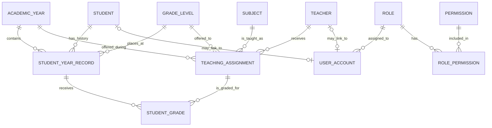

# Entity relationship diagram (ERD)

An ERD is a map of the things the database remembers and how they connect. Read `||--o{` as “one required parent can have zero or many children.”

## Read the relationships in plain English

- A **student** can have one `student_year_record` for each academic year. That row says which grade level they were in that year; it preserves history.
- A **teaching assignment** connects one teacher, one subject, one grade level, and one academic year. In version 1, each subject/level/year combination has one responsible teacher.
- A **student grade** connects a student's year record to a teaching assignment and stores the score and date. The assignment supplies the subject, teacher, year, and grade level.
- An **account** has one role. A student or teacher account can link to its corresponding person record; an administrator account links to neither.
- A **role** can have many permissions, and a permission can belong to many roles. `role_permission` is the junction table that stores those pairs.

## Table creation order

Create tables referenced by foreign keys first:

1. `academic_year`, `grade_level`, `subject`, `student`, `teacher`, `role`, `permission`
2. `student_year_record`, `teaching_assignment`, `user_account`
3. `role_permission`
4. `student_grade`

The complete reference also checks that a grade's student-year record and teacher assignment use the same academic year and grade level. That rule involves more than one table, so a simple `CHECK` constraint is not enough; the reference uses a small trigger and explains it in comments.

## Design prompts

- Why is `student_year_record` separate from `student`?
- Why does `student_grade` connect a student-year record to a teaching assignment instead of having columns like `grade10_math`, `grade10_english`, and `grade11_math`?
- Why is a teacher assignment a separate row rather than a teacher name stored in `subject`?
- Which constraints stop duplicate student/year records or duplicate subject assignments?
- Why should an old academic record be retained instead of overwritten when a student advances?
